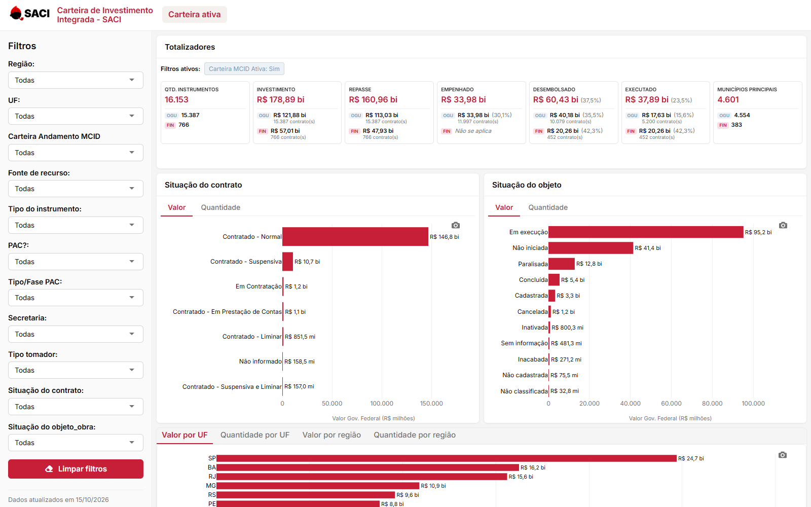

# Carteira de Investimento Integrada - SACI

Painel interativo da carteira de investimentos do Ministério das Cidades (MCID), feito em R com
`flexdashboard` + `shiny`, no padrão visual do sistema SACI.

**Página do projeto:** https://brunotiburcio-git.github.io/painel-carteira-saci/
**Painel online:** https://connect.posit.cloud/brunotiburcio/content/01a14529-004c-3a4d-bcab-bd1566e50107



## O que o painel mostra

- **Totalizadores** no padrão do SACI, com total geral e detalhamento por fonte (OGU / FIN):
  quantidade de instrumentos, investimento, repasse, empenhado, desembolsado, executado e municípios.
  Os cálculos seguem a mesma regra do sistema SACI (`TotalizadoresContratos`), e os valores batem com ele.
- **Filtros ativos** acima dos totalizadores, com "×" para remover cada filtro.
- **Situação do contrato** e **Situação do objeto**, com abas Valor | Quantidade.
- **Valor e quantidade por UF e por região**, e **por tipo de instrumento**.
- **Tabela de contratos** com o `cod_tci` como link para o contrato no SACI.
  - CSV e Excel exportam todos os contratos filtrados (barra lateral + busca e filtros da tabela).
  - "Copiar" copia só a página visível.
- **Download dos gráficos em PNG** já com o título, os filtros aplicados e a data da carga.
- **Modo claro (padrão) e escuro**, com a escolha guardada no navegador.

## Filtros

Região, UF, Carteira Andamento MCID, Fonte de recurso, Tipo do instrumento, PAC, Tipo/Fase PAC,
Secretaria, Tipo tomador, Situação do contrato e Situação do objeto.

## Regras dos totalizadores

| Totalizador | Cálculo |
|---|---|
| Qtd. instrumentos | Contagem de contratos |
| Investimento | Soma de `vlr_investimento` |
| Repasse | Soma de `vlr_repasse` |
| Empenhado | Soma de `vlr_empenhado` (FIN: "Não se aplica") |
| Desembolsado | Soma de `vlr_desembolsado` |
| Executado | OGU (e demais fontes): `vlr_desbloqueado`; FIN: `vlr_desembolsado` |
| Municípios | `id_municipio` distintos, sem nulos |

Os percentuais usam o repasse do mesmo grupo como base, são calculados sobre as somas e têm uma casa
decimal. "X contrato(s)" conta só os contratos com valor maior que zero naquele indicador.

## Como rodar

Requisitos: R 4.4+, RStudio (que já inclui o pandoc) e os pacotes
`flexdashboard`, `shiny`, `dplyr`, `plotly`, `DT`, `scales`, `DBI`, `odbc`, `htmlwidgets`, `readr` e `writexl`.

```r
install.packages(c("flexdashboard", "shiny", "dplyr", "plotly", "DT", "scales",
                   "DBI", "odbc", "htmlwidgets", "readr", "writexl"))
```

1. Configure no Windows a fonte de dados ODBC `PostgreSQLCampinas`, apontando para o banco `corporativo`
   (as credenciais ficam na configuração ODBC, não no código).
2. Abra `carteira_investimentos_mcid.Rmd` no RStudio e clique em **Run Document**.

O painel lê a view `se_saci.view_mat_carteira_investimento`, só com a carteira ativa
(`bln_carteira_ativa_mcid = 'SIM'`). O acesso ao banco é restrito à rede interna, então o painel
só funciona nela. A página no GitHub Pages é apenas a apresentação do projeto.

## Arquivos

| Arquivo | Conteúdo |
|---|---|
| `carteira_investimentos_mcid.Rmd` | O painel: consulta, filtros, totalizadores, gráficos e tabela |
| `app.css` | Estilo no padrão SACI (modo claro e escuro) |
| `logo-saci transparente.png` | Logo do SACI usado no painel |
| `docs/` | Página de apresentação publicada no GitHub Pages |
